# tessera

**Seamless mathematical wallpaper loops.** Islamic star patterns, the Fermi
surfaces of graphene, quantum revivals, three-body choreographies, Lagrangian
pendulums, the Hopf fibration: each one a video whose last frame flows into its
first.

<p align="center">
  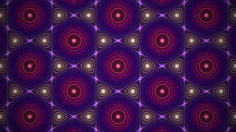
  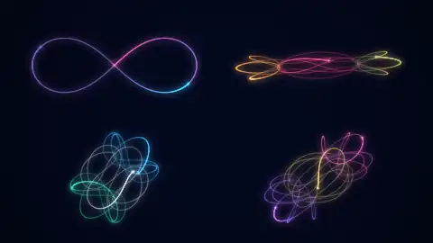
  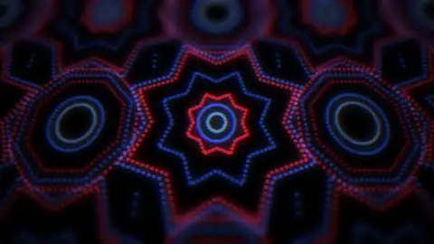
  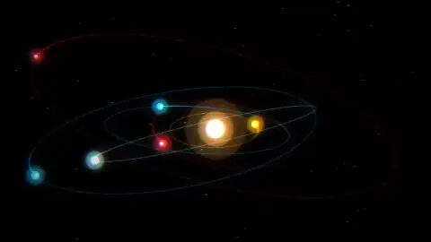
  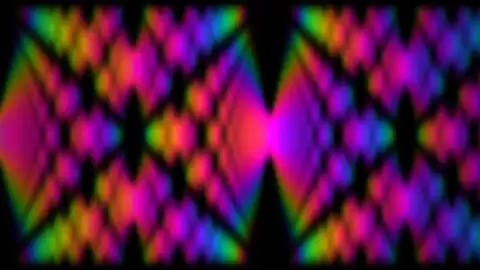
  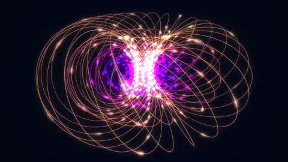
  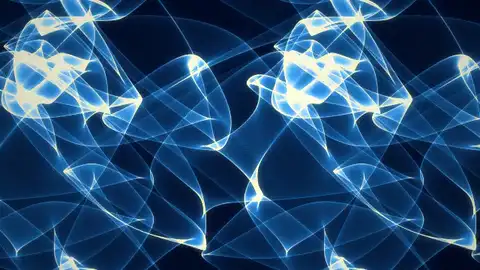
  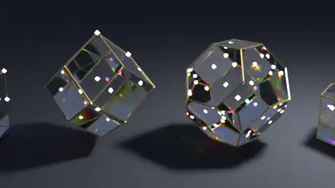
  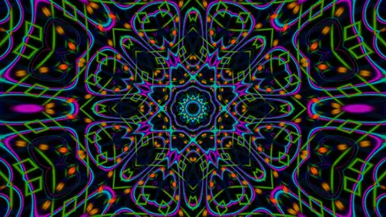
  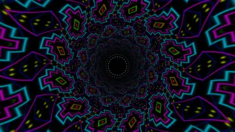
  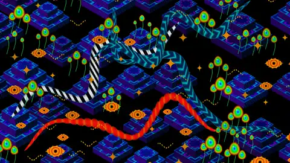
  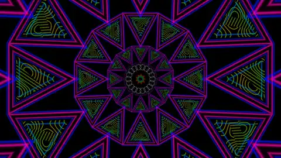
</p>

Every loop is a function of a phase `u ∈ [0, 1)`. An N-frame video samples
`u = i/N`, so frame N is frame 0 again. Nothing is blended at the seam: the
mathematics itself repeats. Where physics does not repeat on its own, the
parameters are chosen so that it does:

- pendulum lengths come from the exact elliptic period, not the small-angle one;
- hydrogen energies are rational, so a superposition shares one common period;
- membrane modes are picked with Pythagorean frequency ratios;
- three-body orbits are closed by Newton shooting to 1e-9.

The camera never turns.

The generic machinery lives in
[desargues](https://github.com/mentat-collective/desargues) under
`desargues.wallpaper.*`: phase helpers, rasterisers, a 3D camera, glow splats,
bloom, motion blur, LuxCore, GPU field shaders and video encoders. This
repository holds the loops.

## Gallery

### Mechanics: Lagrangians and Hamiltonians

| | | |
|---|---|---|
| 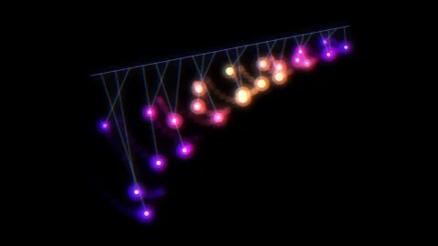 **pendulum-wave**<br>24 nonlinear pendulums. L = ½ml²θ̇² + mgl cos θ through Emmy; lengths from 4√(l/g)·K(sin θ₀/2), so pendulum k swings exactly 18+k times | 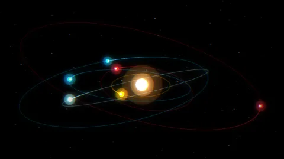 **kepler-resonance**<br>six orbits with periods 12:6:4:3:2:1, Kepler's equation by Newton iteration, inclined planes | 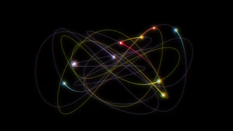 **lissajous-oscillators**<br>3D harmonic oscillators with whole frequencies, checked against the Euler-Lagrange equations |
| 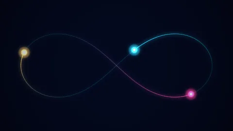 **figure-eight**<br>the Chenciner-Montgomery three-body choreography, Yoshida 4th-order symplectic, energy drift 2e-7 | 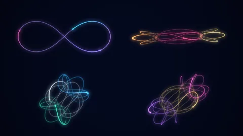 **choreographies**<br>figure-eight, Butterfly I, Moth I and Yin-yang 1a (Šuvakov-Dmitrašinović), shot closed to 1e-9 | 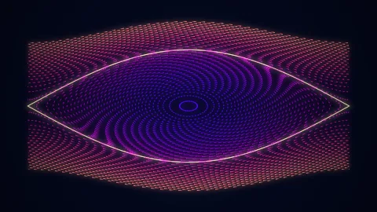 **phase-flow**<br>pendulum phase space H = p²/2 − cos q; each particle turns its action-angle variable a whole number of times |

### Chaos and billiards

| | | |
|---|---|---|
| 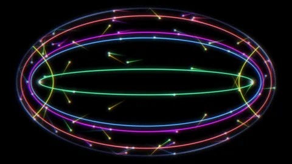 **elliptic-billiard**<br>Poncelet families of closed billiard orbits in an ellipse (rotation numbers 1/9, 1/5, 2/9, 1/3 and a hyperbolic family between the foci), their confocal conic caustics drawn as neon lines | 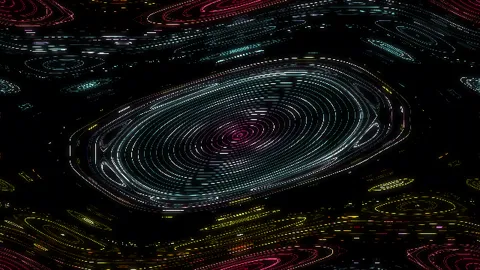 **standard-map**<br>the Chirikov standard map at K = 0.92: rotational tori, island chains and a dim chaotic sea, light crests flowing along each invariant curve in its own angle variable | 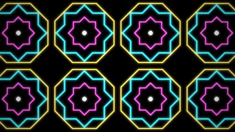 **cat-map**<br>Arnold's cat map on a 322 × 322 torus has period 24 and C¹² = −I, so a centrally symmetric khatam assembles twice per loop; each step is drawn as two sliding shears |

### Delays and periodic noise

Etienne Jacob's techniques (bleuje.com) applied to physics: every element runs the same periodic motion with a delay that depends on where it is, noise is sampled on a circle so it returns, and particles replace each other along their paths.

| | | |
|---|---|---|
| 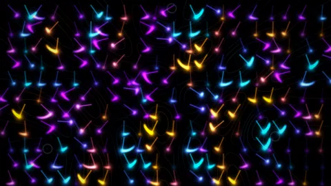 **delay-pendulums**<br>220 exact nonlinear pendulums; amplitude is the \|Huygens field\| of three coherent sources and the delay its phase, so the fringes show as still lanes and the phase fronts drift outward in cyan, violet and gold | 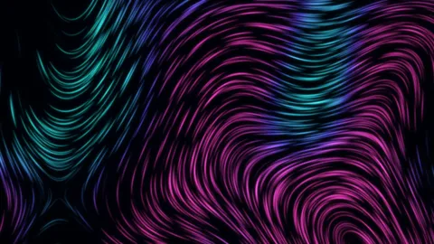 **noise-flow-lines**<br>2304 particles carried by the curl of a periodic 4D stream function ψ(x, y, R cos 2πu, R sin 2πu), each drawing its streamline, fading in to take a neighbour's place; colour by vorticity sign | 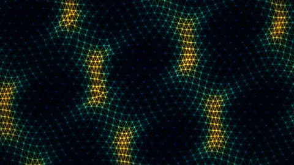 **delay-mesh**<br>a triangular mesh of Gerstner water parcels, each on the same circle delayed by k·x, three wave trains plus a ripple ring leaving once per loop; edges lit on the crests |

### Fluids

| | |
|---|---|
| 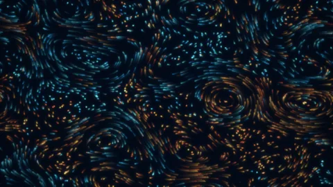 **curl-flow**<br>an incompressible flow v = curl ψ from eight asymmetric modes with integer temporal frequencies; particles fade in and out as they take each other's places, so the loop closes exactly | 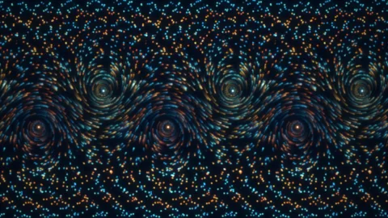 **vortex-street**<br>a von Kármán street of point vortices under the Kirchhoff Hamiltonian H = −(1/4π) Σ ΓᵢΓⱼ log rᵢⱼ with the periodic Green's function; the street advances one period per loop, tracer dye striped by origin |
| 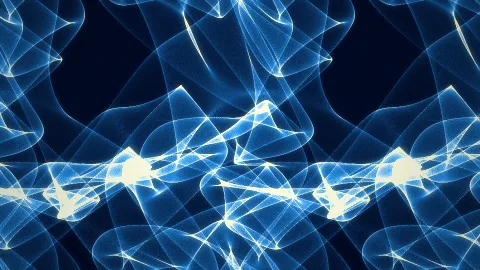 **caustics**<br>sunlight refracted through a periodic water surface (twelve waves with integer wavevectors and frequencies), photons splatted onto the pool floor; the folds glow aqua to white-gold | 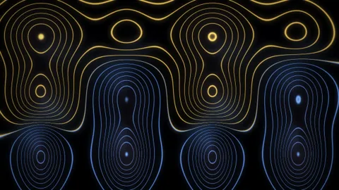 **breathers**<br>sine-Gordon breathers u = 4 atan(√(1−ω²)/ω · sin ωt / cosh √(1−ω²)x), exact periodic solitons with commensurate ω, a lattice of them drawn as glowing signed level sets (warm crests, cool troughs) | 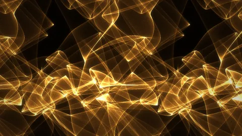 **caustics-gold**<br>the same pool under a finer surface (eighteen waves, shorter wavelengths), a denser photon network in amber and champagne gold |

### Quantum

| | | |
|---|---|---|
| 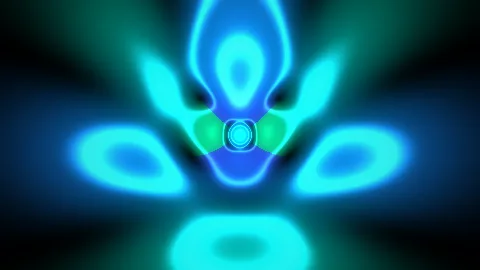 **hydrogen-beat**<br>a 3s/4d/4f/5g superposition; Eₙ = −1/2n² is rational, so ψ returns exactly | 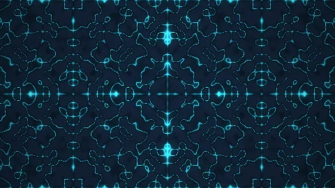 **drum**<br>square membrane modes with Pythagorean frequency ratios, mirrored to fill the frame | 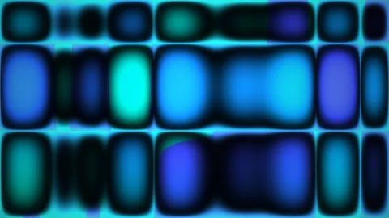 **box-modes**<br>a particle in a 2D box: five modes with commensurate energies 2:5:8:10:10, \|ψ\|² as a saturating glow with iso-density contours, phase as a cyclic hue |
| 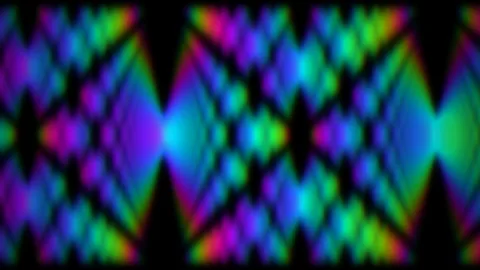 **quantum-tapestry**<br>the Talbot carpet in domain colouring: hue is the phase of ψ(x, t) | 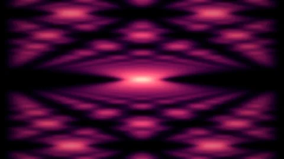 **quantum-carpet**<br>a wave packet in a box; n² energies make the revival exact | 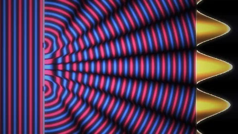 **double-slit**<br>Huygens sources, crests in neon, the screen's cos² intensity as a bar graph |

### 3D

| | | |
|---|---|---|
| 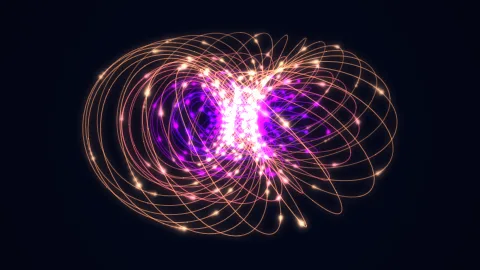 **hopf-fibration**<br>Villarceau circles of S³ → S² on nested tori, stereographically projected, beads flowing along the fibres | 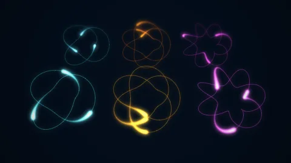 **torus-knots**<br>(p, q) torus knots at fixed poses, light pulses travelling along them, depth of field | 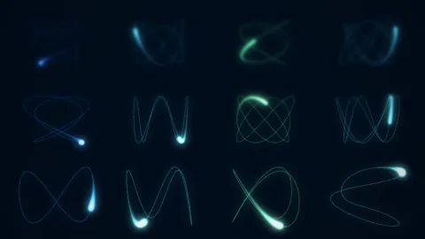 **lissajous-3d**<br>a lattice of 3D Lissajous curves with integer frequency triples, one comet each |

### Fractals in 3D

Sphere-traced from distance estimators (`tessera.raymarch`) with fixed step and iteration budgets, so every frame costs the same and is a pure function of u.

| | | |
|---|---|---|
| 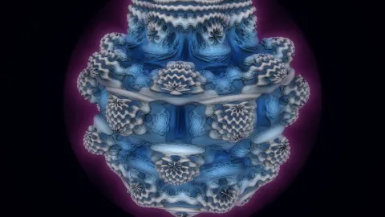 **mandelbulb**<br>the power-8 bulb turns a seventh of a turn per loop, which is its own symmetry (z⁸ turns by 8/7 of a turn), while the key light goes once around; colour by orbit trap | 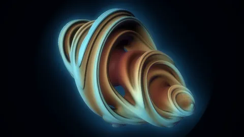 **quaternion-julia**<br>the slice w = 0 of the quaternion Julia set z ↦ z² + c, c once around a closed ellipse in (1, i, j, k); ice palette by orbit trap, the key light once around | |

### Band structures and reciprocal space

| | | |
|---|---|---|
| 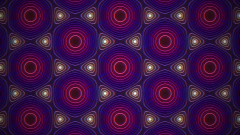 **graphene-fermi**<br>tight-binding \|f(k)\| contours of graphene, Dirac cones at K | 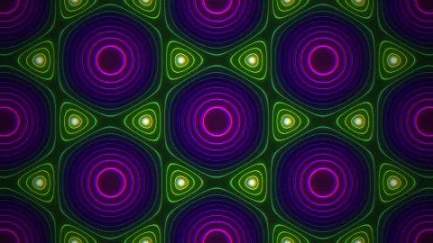 **kagome-fermi**<br>kagome lattice bands | 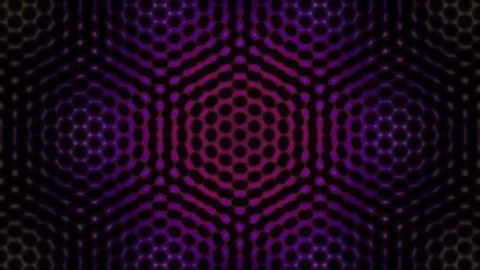 **twisted-bilayer**<br>moiré of two honeycomb layers twisted by 0.11 rad |
| 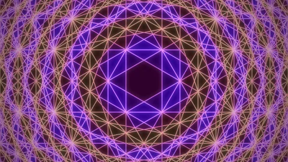 **brillouin-zones**<br>Brillouin zones of the hexagonal lattice, by counting Bragg planes | 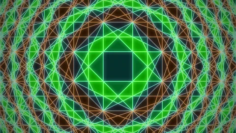 **brillouin-square** | 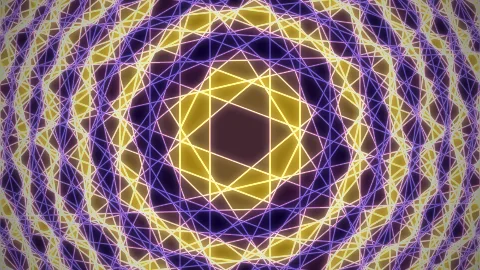 **brillouin-oblique** |
| 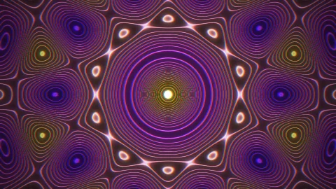 **penrose-fermi**<br>5-fold quasiperiodic band Σ cos(k·eⱼ) | 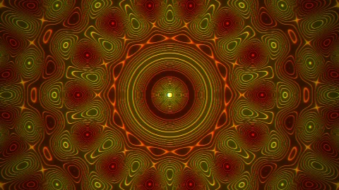 **heptagonal-fermi**<br>7-fold | 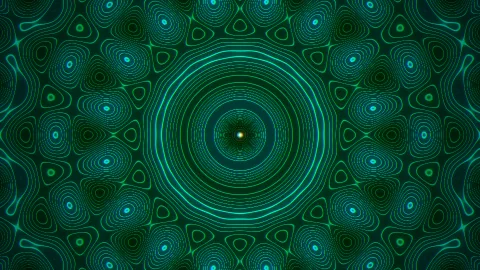 **octagonal-fermi**<br>8-fold |
| 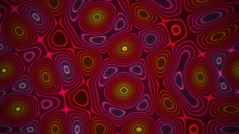 **fold-9** |  **fold-11** |  **fold-12** |
|  **hofstadter**<br>Hofstadter's butterfly: Harper-model spectra at rational flux p/q on the square lattice, a scanner sweeping the flux and lighting the bands it crosses |  **lieb-fermi**<br>Lieb lattice (three-site square cell) Fermi contours; the whole zone flashes as the energy crosses the flat band |  **bloch-oscillation**<br>Gaussian packets in a tight-binding lattice under a constant field, exact complex propagator; Bloch period 2π/Fa closes the loop, sites coloured by phase |

### VJ: UV ornament

Dense blacklight-neon ornament in the spirit of psytrance stage visuals, each one driven by a real field.

| | | |
|---|---|---|
|  **textile-tunnel**<br>an exact ray-cylinder tunnel lined with stepped crosses, nested diamonds and bead chains; the wall travels one motif cell per loop, a dashed mandala pulsing at the vanishing point |  **kaleido-quasicrystal**<br>a five-wave quasicrystal folded into a D8 mirror wedge under a log-radial lens, contours in tiers of cyan, magenta, lime and gold |  **sprite-lattice**<br>a lattice of textile glyphs whose size is graphene's \|1 + e^{ik₁} + e^{ik₂}\| and whose colour is a second slow field; it slides one period per loop |
|  **fabric**<br>an all-over composition: isometric stepped pyramids, striped, scaled and segmented serpents sliding along themselves, rainbow droplet bouquets bobbing on integer beats, lashed eyes and stars, placed by a seeded Poisson disc |  **hyperspace**<br>a starfield seeded on a hex lattice, folded into a D12 kaleidoscope, streaming outward log-radially; the field is self-similar under ×2, so one doubling closes the loop |  **flower-mandala**<br>a twelve-fold triangular tunnel in magenta and blue double outlines, labyrinth worms and hatching in lime and gold, a ring of dashed circles at the centre; one self-similar step per loop |

### Composed scenes

These are not hand-written loops. Each is an EDN scene in `tessera.compose`: layers of motifs (stepped crosses, pyramids, serpents, droplets, eyes, mandalas) placed by layouts (Poisson disc, lattices, kaleidoscope folds, tunnels, self-similar zooms) and driven by periodic modulators (fields, integer beats, delays). Every modulator is periodic in u, so the loop closes by construction. fabric and kaleido-quasicrystal rebuilt as scenes are bit-exact against the hand-written versions, and `tessera.compose.generate` composes new scenes from a seed.

| | | |
|---|---|---|
|  **temple**<br>isometric pyramids and droplet bouquets in a D8 kaleidoscope, sizes driven by a quasicrystal field |  **serpent-garden**<br>striped, scaled and segmented serpents over a glyph lattice sized by graphene's \|f(k)\|, droplets on delayed beats |  **mandala-tunnel**<br>flower-mandala wedges mapped onto a tunnel wall, bead chains running toward the vanishing point |
|  **generated-2**<br>a seeded composition: glyph kaleidoscope around a petal medallion |  **generated-3**<br>a seeded composition: serpents and bouquets over one dim palette-tier background | |

### Ornament, curves and fractals

| | | |
|---|---|---|
|  **neon-pulse**<br>khatam stars as glowing beads on a breathing beat, bloom and red/blue fringe |  **neon-khatam**<br>eight-pointed stars and octagons on a tilted plane |  **girih-light**<br>Hankin's polygons-in-contact on 4.8.8, the contact angle breathing |
|  **girih-assembly**<br>the ceiling comes apart in a radial wave and settles back |  **moore-comets**<br>two closed Moore curves with comets |  **julia-orbit**<br>the Julia set of c = 0.7885·e^{2πiu} |
|  **quasicrystal**<br>seven plane waves, phases once around |  **sierpinski-zoom**<br>a zoom by its own similarity ratio, 2 |  **girih-drift**<br>six-fold stars drifting one lattice period |

### Path traced (LuxCore)

<p align="center">
  
</p>

**bz-glass**: the first Brillouin zones of the simple cubic, BCC, FCC and
hexagonal lattices (cube, rhombic dodecahedron, truncated octahedron, hexagonal
prism), cut from their Bragg planes and rendered as dispersive glass with gold
edges. The high-symmetry points Γ, X, L, W, K and U glow. Only the lamp moves.
Rendered on the GPU by LuxCore (`tessera.bz3d`).

**girih-gold**: gold strands over glazed lapis stars, an area lamp orbiting
once per loop.

## Render

Needs a JDK and `ffmpeg`.

```sh
clojure -M:render --list
clojure -M:render --preview                          # out/<id>.png + a 480x270 GIF each
clojure -M:render --only graphene-fermi --format mp4 # 1920x1080, the loop's own length
clojure -M:render --only kepler-resonance,drum --format webm --size 2560x1440 --out out/4k
clojure -M:test                                      # every loop's seam, plus the physics checks
```

Formats: `mp4` (H.264, yuv420p), `webm` (VP9), `gif`, `png` (a numbered
sequence). To use one as a desktop background, play it with
`mpv --loop-file=inf` under `xwinwrap`.

Against a local desargues checkout instead of the pinned git sha:

```sh
clojure -Sdeps '{:deps {io.github.mentat-collective/desargues {:local/root "../desargues"}}}' -M:render --preview
```

## Live shader layers

Ten loops are also written as desargues field forms in `tessera.layers` (graphene, kagome, square, penrose, heptagonal and octagonal Fermi contours, quasicrystal, lieb, brillouin-zones and kaleido-quasicrystal). Each matches its rendered loop bit for bit and compiles to GPU shaders, so a VJ host can run it live at any resolution with its real parameters as controls:

```clojure
(require '[tessera.layers :as layers])
(layers/emit-trama! "out/layers")      ; fosfora trama sources: <id>.wgsl
(layers/emit-isf! "out/layers/isf")    ; ISF v2 layers for other VJ hosts
```

Each layer's phase is a rate parameter, so it loops seamlessly at any tempo. Parameter order is part of the layer's interface and only ever grows at the end, because saved bindings refer to slots. For fosfora, point `FOSFORA_TRAMA_DIRS` at `out/layers/`: new files load live and edits hot-swap.

## Live preview

From a REPL, `desargues.wallpaper.preview` keeps one mpv window looping the
current loop. `show!` renders at 640x360 in the background and swaps it in.

```clojure
(require '[desargues.wallpaper.preview :as pv] '[tessera.loops :as loops])
(pv/show! (loops/all :kepler-resonance))   ; edit, re-eval, show! again
```

## Adding a loop

A loop is a map:

```clojure
{:id :my-loop :seconds 12 :fps 30 :size [1920 1080] :view [14.22 8.0]
 :field (fn [u] (fn ^long [^double x ^double y] 0xRRGGBB))   ; per-pixel layer
 :frame (fn [u] {:background "#0b1f3a" :shapes [...]})        ; vector layer
 :splat (fn [u] rows)                                         ; additive 3D glow points
 :light (fn [u] (fn ^double [^double x ^double y] k))         ; brightness
 :post  (fn [u] [[:bloom {...}] [:vignette {...}]])           ; post effects
 :blur  {:samples 3 :shutter 1}                               ; motion blur, seam-exact
 :ss 2}                                                       ; supersampling
```

- Build every motion from `desargues.wallpaper.loop` (`wave`, `osc`, `window`,
  `pulse`, `circle`, `shift`) so it is periodic in `u`.
- A palette cycled by phase needs integer frequencies (`tessera.palette`, on
  thi.ng/color), or the colours jump at the wrap.
- 3D loops use `desargues.wallpaper.space`: a fixed pinhole camera, depth cue
  and near clipping.
- A per-pixel shader written as a field form (`desargues.wallpaper.field`) also
  runs on the GPU through raster and OpenCL: about 16 ms per 1080p frame on an
  RTX 4070, against 40 ms on the JVM.
- `clojure -M:test` compares every loop's wrap with its ordinary
  frame-to-frame motion.

## Path-traced loops (LuxCore)

A loop with `:scene (fn [u] scene-map)` is rendered by the `:luxcore` engine of
`desargues.wallpaper.luxcore`. The scene map becomes LuxCore `.scn`/`.cfg` text,
and `luxcoreconsole` renders each frame (`DESARGUES_LUXCORE` picks another
binary).

```sh
clojure -M:render --only girih-gold --format mp4
```

A scene's `:config` map is written into LuxCore's render config. `bz-glass`
uses it to render on the GPU: `renderengine.type = PATHOCL` with the CPU devices
off, Intel OIDN denoising and a fixed exposure. The first GPU run compiles
kernels for about two minutes; later runs reuse the cache. On an RTX 4070 laptop
GPU at 32 spp a frame takes about 5 s at 640x360 and 24 s at 1920x1080.

## How it was made

The early loops were built in conversation with Claude. The physics loops were
then built by a swarm of agents (Claude, GPT and Kimi) working in parallel
branches. Each loop was checked for an exact seam and reviewed frame by frame
before it was merged.
